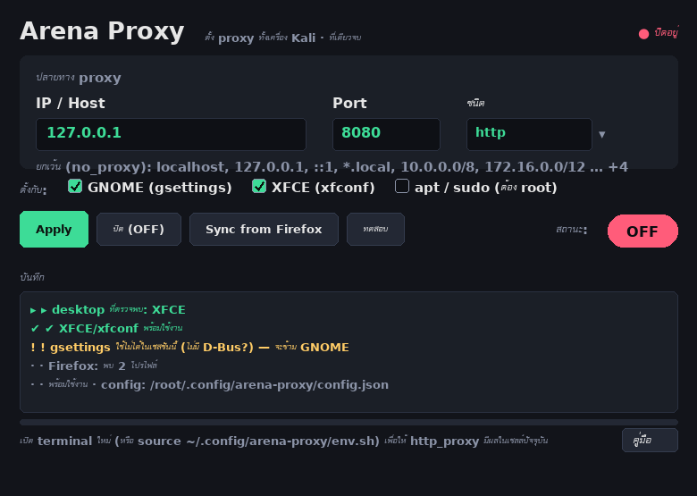
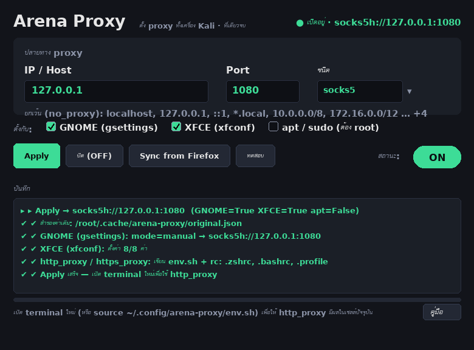

# 10 — Arena Proxy GUI (ตั้ง proxy ทั้งเครื่องบน Kali Linux)

> **ปัญหาที่แก้:** บน Kali การตั้ง proxy ให้ "ทั้งเครื่อง" ต้องแก้ทีละที่ —
> `gsettings` ของ GNOME, `xfconf` ของ XFCE, `http_proxy` ในเชลล์, `apt`, และ Firefox
> พิมพ์ผิดที่เดียวก็พัง ตัวนี้ทำทั้งชุดจาก **ช่อง IP + Port เดียว**





> ภาพทั้งสองสร้างจาก **widget tree จริง** ที่โค้ดสร้าง (`tests/render_preview.py`)
> ไม่ใช่ภาพวาดมือ — แก้หน้าจอแล้วรันสคริปต์ใหม่ ภาพจะเปลี่ยนตาม
>
> ```bash
> # ต้องมี pillow + ฟอนต์ไทย (ถ้าไม่มีฟอนต์ไทย ภาพจะเป็นภาษาอังกฤษแทนกล่องเปล่า)
> pip install pillow
> git clone --depth 1 https://github.com/sirisakboy/thai-font.git /tmp/thai-font
> THAI_FONT_DIR=/tmp/thai-font python3 tools/proxy-gui/tests/render_preview.py
> ```
>
> สคริปต์เลือกฟอนต์อัตโนมัติ: repo `sirisakboy/thai-font` (CC0) → ฟอนต์ในระบบ
> (Noto Sans Thai / TLWG) → fallback อังกฤษ และทำ **font fallback ระดับตัวอักษร**
> แบบเดียวกับที่ Tk/Pango ทำ (ฟอนต์ไทยไม่มี ✔ ▸ ● จึงสลับไป DejaVu เฉพาะตัวนั้น)

## ติดตั้ง

```bash
# 1) ดึง repo (ครั้งเดียว)
git clone --depth 1 https://github.com/sirisakboy/2027-1.git
cd 2027-1/tools/proxy-gui

# 2) ตรวจความพร้อมก่อน (ไม่แก้อะไร)
bash arena-proxy.sh --check

# 3) ติดตั้งลงเมนูแอป แล้วเปิดจากเมนู "Arena Proxy"
bash arena-proxy.sh --install

# หรือรันตรง ๆ ไม่ติดตั้ง
bash arena-proxy.sh
```

| คำสั่ง | ทำอะไร |
|---|---|
| `bash arena-proxy.sh` | เปิด GUI (ติดตั้ง `python3-tk` ให้ก่อนถ้ายังไม่มี) |
| `bash arena-proxy.sh --check` | รายงานว่าขาดอะไร (tkinter / gsettings / D-Bus / Firefox) |
| `bash arena-proxy.sh --install` | วาง `.desktop` ลงเมนูของผู้ใช้ |
| `sudo bash arena-proxy.sh --install --system` | วางทั้งเครื่อง (`/usr/share/applications`) |
| `bash arena-proxy.sh --uninstall` | เอาออกจากเมนู |
| `bash arena-proxy.sh --cli on 127.0.0.1 8080` | ใช้แบบไม่มีจอ (SSH ได้) |
| `bash arena-proxy.sh --cli off` / `status` | ปิด / ดูสถานะ |

## ปุ่มต่าง ๆ ทำอะไร

### Apply

ใส่ IP + Port แล้วกด **Apply** — จะทำตามลำดับนี้ (ข้ามได้ด้วย checkbox)

1. **สำรองค่าเดิม** ของ `gsettings` ไว้ครั้งแรกครั้งเดียว → กด OFF แล้วคืนได้
2. **GNOME** — `gsettings` ทั้งชุด:
   ```bash
   gsettings set org.gnome.system.proxy mode manual
   gsettings set org.gnome.system.proxy.http  host 127.0.0.1
   gsettings set org.gnome.system.proxy.http  port 8080
   gsettings set org.gnome.system.proxy.https host 127.0.0.1
   gsettings set org.gnome.system.proxy.https port 8080
   gsettings set org.gnome.system.proxy ignore-hosts "['localhost','127.0.0.1',...]"
   ```
3. **XFCE** — ค่าเริ่มต้นของ Kali (ถ้าติดตั้ง `xfconf-query`)
4. **http_proxy / https_proxy** — เขียน `~/.config/arena-proxy/env.sh` แล้วใส่บล็อก
   `source` ลง `~/.zshrc` / `~/.bashrc` / `~/.profile` (มี marker กันซ้ำ)
5. **apt / sudo** — เขียน `/etc/apt/apt.conf.d/95arena-proxy` (ต้อง root)

> **ต้องเปิด terminal ใหม่** (หรือ `source ~/.config/arena-proxy/env.sh`)
> เพราะตัวแปรสภาพแวดล้อมของ shell ที่เปิดอยู่แล้วแก้ไม่ได้จากข้างนอก

### Sync from Firefox

อ่าน `prefs.js` / `user.js` ของทุกโปรไฟล์ แล้วเติมค่าให้:

| ใน Firefox | ได้มาเป็น |
|---|---|
| `network.proxy.type = 1` (manual) | ใช้ได้ |
| `network.proxy.http` + `_port` | host/port ชนิด `http` |
| `network.proxy.socks` + `_port` | host/port ชนิด `socks5` (ถ้าตั้ง `socks_version` 4/5) |
| `network.proxy.no_proxies_on` | รวมกับ `no_proxy` ที่จำเป็น (ไม่ทิ้ง localhost) |
| `type = 0` (ไม่มี proxy) | เตือน ไม่ทับค่าที่พิมพ์ไว้ |
| `type = 5` (ใช้ system proxy) | เตือนว่าค่าจริงอยู่ใน gsettings |

ค้นหาใน `~/.mozilla/firefox`, `~/snap/firefox/common/.mozilla/firefox`,
`~/.var/app/org.mozilla.firefox/...` — รองรับทั้ง apt / snap / flatpak

> **Sync ไม่ได้เปิด proxy ให้เอง** — แค่เติมช่องให้ ต้องกด Apply ต่อ (กันตั้งค่าพลาด)

### ON / OFF (สวิตช์)

- **OFF** → `gsettings ... mode none`, `xfconf ... mode none`,
  `env.sh` เป็น `unset`, ลบ `apt.conf`, **คืนค่า gsettings เดิมจาก snapshot**
- **ON** → เหมือนกด Apply ด้วยค่าที่กรอกไว้

### ทดสอบ

1. เปิด TCP ไปที่ IP:Port (ตรวจว่า proxy/VPN ตื่นอยู่)
2. ยิง `curl -x http://IP:Port https://ifconfig.me/ip` (ถ้าไม่มี curl ข้าม)
3. รายงานในช่องบันทึก

## no_proxy ที่ใส่มาให้ (สำคัญ)

```
localhost, 127.0.0.1, ::1, *.local,
10.0.0.0/8, 172.16.0.0/12, 192.168.0.0/16, 100.64.0.0/10,
10.8.0.0/24, 10.9.0.0/24
```

| รายการ | ทำไมต้องมี |
|---|---|
| `127.0.0.1`, `localhost` | **ห้ามตัดออก** — ถ้า proxy อยู่เครื่องเดียวกันจะ loop และ portal/VPN API พัง |
| `10.8.0.0/24` | WireGuard ของ Arena VPN |
| `10.9.0.0/24` | OpenVPN ของ Arena VPN |
| `100.64.0.0/10` | CGNAT ของเน็ตบ้าน — กัน proxy วกกลับเข้าเน็ตตัวเอง |

## ใช้ร่วมกับ Arena VPN

GUI นี้ออกแบบให้ใช้คู่กับ SOCKS5 ของ Arena VPN (ดู [03-platforms.md](03-platforms.md))

```bash
# 1) เปิด SOCKS5 ผ่าน SSH (จากเครื่องที่ไม่มี TUN ก็ได้)
arena-vpn proxy start ubuntu@<vm-ip>

# 2) เปิด Arena Proxy → IP = 127.0.0.1, Port = 1080, ชนิด = socks5 → Apply

# 3) ทุกอย่างในเครื่อง (GUI app, Firefox, curl, apt) ออกผ่าน VPN
```

> ถ้าตั้ง proxy ชี้ไปที่ SOCKS5 ของ VPN แล้วอยากให้ **Firefox** ใช้ด้วย
> ให้ตั้ง Firefox เป็น `type=5` (Use system proxy) — จะอ่าน `gsettings` อัตโนมัติ
> หรือกด **Sync from Firefox** กลับทาง (Firefox → GUI) ก็ได้

## แก้ปัญหา

| อาการ | สาเหตุ | วิธีแก้ |
|---|---|---|
| `ModuleNotFoundError: tkinter` | Kali ไม่ลง `python3-tk` มาให้ | `sudo apt install python3-tk` (สคริปต์ทำให้อัตโนมัติ) |
| `ไม่พบ DISPLAY` | รันผ่าน SSH | `ssh -X` หรือใช้ `--cli` |
| GNOME ไม่เปลี่ยน | ไม่มี D-Bus (รันด้วย sudo/ssh) | เปิดจาก terminal ในเดสก์ท็อป ไม่ต้อง sudo |
| `gsettings` ขึ้น error | ไม่มี GNOME (Kali = XFCE) | ปกติ — ใช้ XFCE แทน ติ๊กออกที่ GNOME |
| `apt` ไม่เปลี่ยน | ไม่ได้เป็น root | เปิดผ่านไอคอนเมนู (ใช้ `pkexec`) หรือ `sudo -E` |
| ตั้งแล้ว curl ยังไม่เปลี่ยน | shell เก่ายังถือค่าเดิม | เปิด terminal ใหม่ / `source ~/.config/arena-proxy/env.sh` |
| Sync ไม่เจอโปรไฟล์ | ยังไม่เคยเปิด Firefox | เปิด Firefox หนึ่งครั้งก่อน |
| เน็ตหายหลัง Apply | proxy ตาย/IP ผิด | กด **OFF** → คืนค่าเดิมทันที |

## ความปลอดภัย

- คำสั่งทั้งหมดเรียกผ่าน `subprocess.run(list)` — **ไม่มี `shell=True`, ไม่มี `os.system`**
- IP/Host ถูกตรวจด้วย allowlist อักขระ → กัน `; rm -rf /`, `$(...)`, backtick, ขึ้นบรรทัดใหม่
- ไฟล์ config เป็น `0600`
- **ไม่เก็บรหัสผ่าน proxy** — ถ้า proxy ต้องใช้ user:pass ให้ตั้งในโปรแกรมเอง
  (การฝังรหัสใน env เป็นที่รู้กันว่าไม่ปลอดภัย)
- `apt.conf` เขียนเฉพาะเมื่อเป็น root และเป็นไฟล์ชื่อเฉพาะ (`95arena-proxy`) ลบง่าย

## เทสต์

```bash
python3 tools/proxy-gui/tests/test_gui.py      # 174 checks, ไม่ต้องมีจอ/ไม่ต้องมี Kali
```

เทสต์ครอบ: คำสั่ง `gsettings`/`xfconf` ที่สร้าง · env.sh ที่ `source` ได้จริง ·
snapshot/คืนค่า · อ่าน `prefs.js` (รวม escape `\u002C` แบบที่ Firefox เขียนจริง) ·
snap/flatpak · **กดทุกปุ่มจริง** บน tkinter stub · ค่าอันตราย · dry-run

## เอกสารที่เกี่ยวข้อง

- [03-platforms.md](03-platforms.md) — สร้าง VPN server (Cloud Shell / GCP / AWS / Oracle / บ้าน)
- [05-แก้ปัญหา.md](05-แก้ปัญหา.md) — ปัญหา VPN
- [02-คำสั่งทั้งหมด.md](02-คำสั่งทั้งหมด.md) — คำสั่ง `arena-vpn` ทั้งหมด
